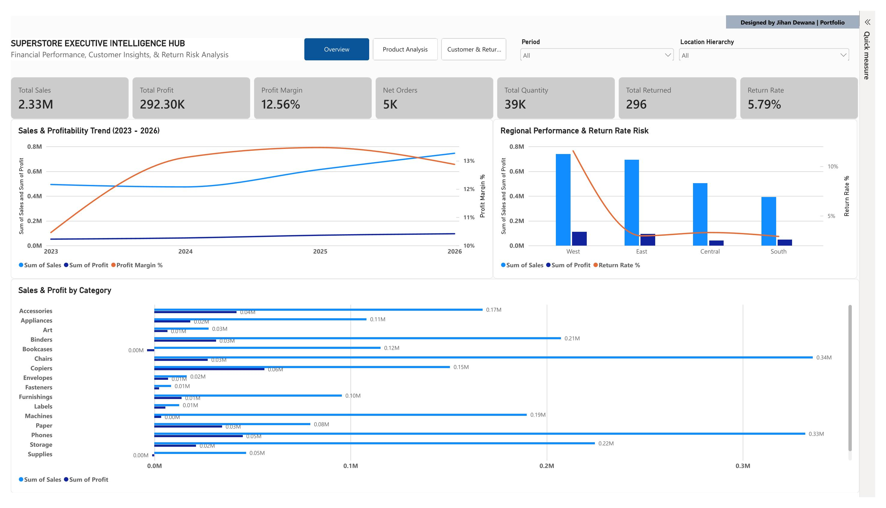
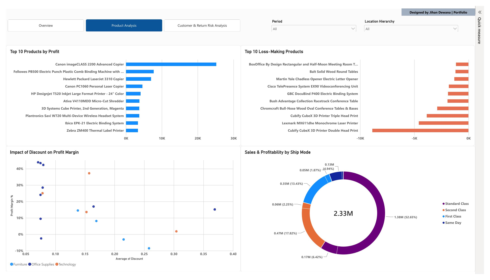
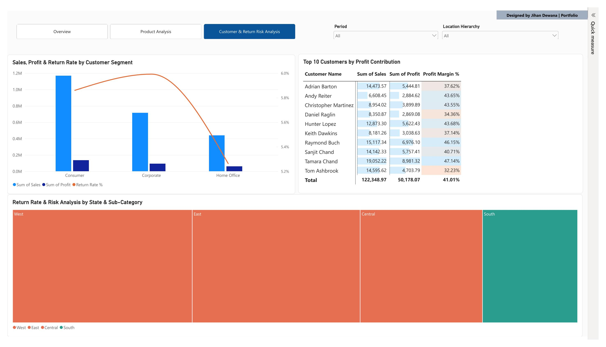

# 📊 Superstore Executive Intelligence Hub

An executive-level interactive Power BI dashboard designed to provide end-to-end business insights—covering financial performance, product profitability, customer value segmentation, and operational return risk.

---

## 📸 Dashboard Overview

### Page 1: Executive Overview

*Provides a high-level snapshot of overall business performance, featuring multi-year sales & profit trends, regional metrics, category-level breakdowns, and core KPI cards.*

### Page 2: Product & Discount Analysis

*Deep-dives into product-level performance, showcasing top profit-generating items, loss-making product identification, discount vs. profit margin elasticity, and shipping mode distribution.*

### Page 3: Customer & Return Risk Deep-Dive

*Analyzes customer value behavior across market segments, top-performing accounts, and operational return risks integrated via custom 3-tier risk grading.*

---

## 🔑 Key Performance Indicators & Metrics (Overview Page)

* **Total Sales:** $2.33M
* **Total Profit:** $292.30K
* **Overall Profit Margin:** 12.56%
* **Net Orders:** 5K
* **Total Quantity Sold:** 39K
* **Total Returned Orders:** 296
* **Overall Return Rate:** 5.79%

---

## 🛠️ Technical Implementation & Architecture

* **Data Modeling:** Built on a robust Star Schema architecture connecting `Orders` and `Returns` tables with bidirectional filtering configuration to ensure accurate cross-filtering and metric calculations.
* **Advanced DAX Measures:** 
  * Custom calculation for `Profit Margin %` and dynamic `Return Rate %` using `DIVIDE` and `CALCULATE` functions to handle complex relational contexts.
* **Conditional Formatting & UI/UX Standards:**
  * Implemented a 3-tier gradient and rule logic for return risks (Teal `< 5%` for Low Risk, Amber `5%-10%` for Moderate Risk, and Coral `> 10%` for High Risk).
  * Locked spatial layouts using Power BI selection panes to maintain visual consistency across pages.
  * Cohesive executive color palette: Teal (`#2A9D8F`), Amber (`#E9C46A`), and Coral (`#E76F51`).

---

## 📂 Project Repository Structure

```text
├── dataset/                    # Sample Superstore dataset (.csv / .xlsx)
├── images/                     # High-resolution dashboard screenshots
│   ├── Superstore_Executive_Intelligence_Hub-1.jpg
│   ├── Superstore_Executive_Intelligence_Hub-2.jpg
│   └── Superstore_Executive_Intelligence_Hub-3.jpg
├── Superstore_Executive_Intelligence_Hub.pbix  # Main Power BI dashboard file
└── README.md                   # Comprehensive project documentation
